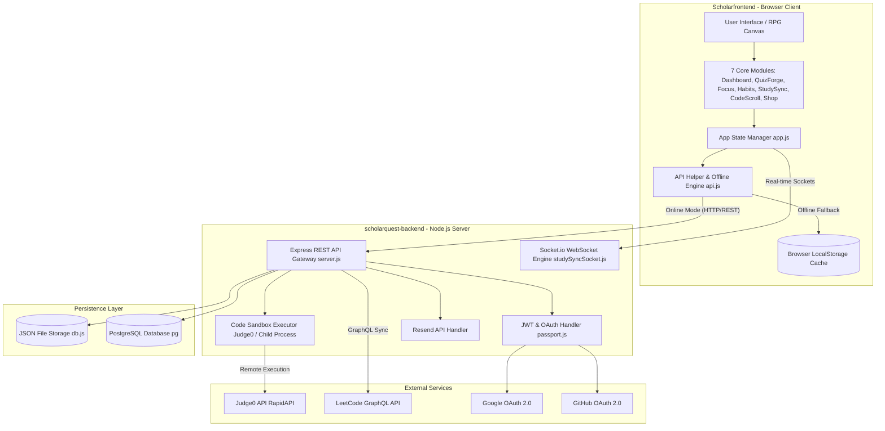
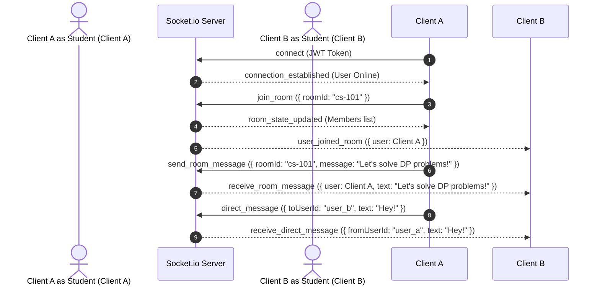

# ⚔️ ScholarQuest — Complete Technical Architecture & End-to-End Documentation

> **MSc IT Mini Project 2026** | Gamified Learning Platform & Interactive Developer Arena  
> **System Architecture**: Decoupled Full-Stack Architecture (Client-Side SPA + Real-Time REST & WebSocket Backend)  
> **Repository**: [Jaish15/scholarquest-frontend](https://github.com/Jaish15/scholarquest-frontend) & [Jaish15/scholarquest-backend](https://github.com/Jaish15/scholarquest-backend)

---

## 📋 Table of Contents
1. [Executive Summary](#-executive-summary)
2. [High-Level Architecture & System Data Flow](#-high-level-architecture--system-data-flow)
3. [Frontend Tier (`Scholarfrontend`)](#-frontend-tier-scholarfrontend)
   - [Tech Stack & Dependencies](#tech-stack--dependencies)
   - [Design System & UI/UX Standards](#design-system--uiux-standards)
   - [Core Modules Technical Specification](#core-modules-technical-specification)
   - [State Management & Offline Engine (`api.js`)](#state-management--offline-engine-apijs)
4. [Backend Tier (`scholarquest-backend`)](#-backend-tier-scholarquest-backend)
   - [Tech Stack & Core Libraries](#tech-stack--core-libraries)
   - [REST API Endpoints Specification](#rest-api-endpoints-specification)
   - [Real-Time WebSocket Engine (`Socket.io`)](#real-time-websocket-engine-socketio)
   - [Multi-Language Code Execution Sandbox (Judge0 + Native Child Process)](#multi-language-code-execution-sandbox-judge0--native-child-process)
   - [Authentication & OAuth 2.0 Workflows](#authentication--oauth-20-workflows)
5. [Database Architecture & Persistence](#-database-architecture--persistence)
6. [Game Mechanics & Mathematical Formulas](#-game-mechanics--mathematical-formulas)
7. [Installation & Execution Guide](#-installation--execution-guide)
8. [Security & Reliability Engineering](#-security--reliability-engineering)

---

## 🌟 Executive Summary

**ScholarQuest** is a production-grade, full-stack gamified learning platform and interactive developer arena. Designed specifically to transform academic productivity and coding practice into a pixel-RPG adventure, ScholarQuest combines real-time collaboration, interactive multi-language coding sandboxes, productivity trackers, and a multi-tiered reward economy (XP, HP, coins, unlockable avatars).

The application is architected into two decoupled tiers:
1. **Frontend SPA (`Scholarfrontend`)**: A high-performance, single-page application built using native HTML5, modular JavaScript (ES Modules), custom glassmorphism CSS, and selective React 18 micro-components.
2. **Backend API (`scholarquest-backend`)**: An Express.js REST API and Socket.io WebSocket server providing user management, authentication, real-time messaging/study rooms, Judge0 multi-language code execution, and persistent progress tracking.

---

## 📐 High-Level Architecture & System Data Flow



---

## 🎨 Frontend Tier (`Scholarfrontend`)

### Tech Stack & Dependencies

| Layer | Technology | Purpose / Role |
|---|---|---|
| **Structure** | HTML5 (Semantic) | Single-Page Application DOM structure across all 7 modules |
| **Styling** | Vanilla CSS3 | Custom CSS variables, glassmorphism, responsive grid/flex layouts |
| **Logic Engine** | Vanilla JavaScript (ES6 Modules) | Modular script separation for domain logic and state orchestration |
| **Micro-Components** | React 18 (CDN) | Used for dynamic complex UI controls like `AvatarSelector.jsx` |
| **Real-time Client** | `socket.io-client` v4 | Bi-directional communication for study rooms, presence, and chat |
| **Icons & Typography** | Lucide Icons, Google Fonts | *Outfit* (UI typography) and *JetBrains Mono* (Code IDE) |

### Design System & UI/UX Standards

ScholarQuest employs a **Dark Gold Pixel-RPG Design System**:
- **Primary Color Palette**: Gold (`#f59e0b`), Deep Obsidian (`#0f172a`), Dark Slate (`#1e293b`), and Emerald (`#10b981`).
- **Glassmorphism**: Semi-transparent card backdrops with `backdrop-filter: blur(12px)` and subtle gold inset borders (`rgba(245, 158, 11, 0.2)`).
- **Animations**: CSS `@keyframes` for level-up pulse effects, smooth progress-bar fills, pixel sprite bounces, and toast notifications.

### Core Modules Technical Specification

```
Scholarfrontend/
├── index.html        # Central SPA shell containing all 7 view modules
├── style.css         # Design system, CSS variables, utility classes, layout rules
├── app.js            # State orchestrator, navigation router, global UI updates
├── api.js            # Dual-mode REST API client with automatic offline fallback
├── modules/
│   ├── avatar.js     # Sprite rendering, canvas animation, character switching
│   ├── quiz.js       # QuizForge battle engine, question rendering, scoring logic
│   ├── focus.js      # Focus Arena / Pomodoro timer with anti-cheat blur detection
│   ├── habits.js     # HabitDojo tracker with streak multipliers & penalty checks
│   ├── studysync.js  # StudySync room management, friend lists, direct messaging
│   ├── codescroll.js # CodeScroll feed, IDE editor, Judge0 code runner
│   └── shop.js       # Shop item rendering, coin transactions, inventory management
└── src/
    └── data/
        ├── codeScrollBank.js # Embedded coding challenges bank
        └── quizBank.js       # Fallback offline quiz bank across multiple domains
```

1. **Dashboard Module**: Calculates overall character stats, progress bars (XP, HP), daily streak counts, coins, and achievement unlocks.
2. **QuizForge Module**: Handles category-based multiple-choice battles, real-time timer countdowns, immediate answer validation, and XP/coin award calculations.
3. **Focus Arena Module**: Implements customizable Pomodoro timers (Work: 25m, Break: 5m, Long Break: 15m), tracking active focus minutes and awarding XP upon completed intervals. Features tab-visibility anti-cheat listeners.
4. **HabitDojo Module**: Tracks daily habit checklists, streak growth multipliers, and applies daily HP penalties for missed core habits.
5. **StudySync Module**: Real-time collaborative learning dashboard featuring room creation/joining, active participant user lists, real-time socket chat, direct messages (DMs), and friend management.
6. **CodeScroll Module**: Gamified coding challenge feed with an integrated code editor. Supports language selection (Python, JS, C, C++, Ruby), code submission to the backend sandbox runner, test case verification, and LeetCode profile statistic sync.
7. **Shop & Inventory Module**: Handles purchasing unlockable pixel-art character avatars (20+ sprites), stat boosters, and equipping items in real time.

### State Management & Offline Engine (`api.js`)

The frontend features a dual-layer data management engine (`api.js`):
- **Online Mode**: When connected to the Express backend (`http://localhost:3000`), requests use HTTP `fetch` with JWT Bearer headers (`Authorization: Bearer <token>`).
- **Offline Fallback**: If the server is unreachable or offline, `api.js` automatically diverts CRUD calls to browser `localStorage`. Player progress, offline quizzes, habits, and shop purchases are cached locally and synchronized upon backend reconnection.

---

## ⚙️ Backend Tier (`scholarquest-backend`)

### Tech Stack & Core Libraries

```
scholarquest-backend/
├── server.js              # Express app entry point & HTTP/WebSocket server launcher
├── db.js                  # Data storage abstraction layer (JSON file DB / PostgreSQL)
├── middleware/
│   └── auth.js            # JWT verification & Bearer token parsing middleware
├── routes/
│   ├── auth.js            # Authentication routes (Register, Login, OAuth, Pass Reset)
│   ├── user.js            # User profile, state updates, LeetCode linking
│   ├── quiz.js            # Quiz fetching, evaluation, submit handling
│   ├── habits.js          # Habit management CRUD
│   ├── leaderboard.js     # Leaderboard ranking calculations
│   ├── friends.js         # Friend requests and social relationships
│   └── dm.js             # Direct messaging & file uploads
├── modules/
│   ├── studySyncSocket.js # WebSocket event handlers for rooms, presence, DMs
│   └── studySyncStore.js  # Socket state management store
└── data/                  # Persistent JSON storage files
```

| Package / Tool | Version | Role in Architecture |
|---|---|---|
| **Node.js** | v18 / v20 / v24 | JavaScript server runtime environment |
| **Express.js** | ^4.18.2 | Web framework for REST API route handling |
| **Socket.io** | ^4.8.3 | WebSockets server engine for real-time channels |
| **jsonwebtoken** | ^9.0.2 | Signing and verifying stateless JWT auth tokens |
| **bcryptjs** | ^2.4.3 | Hashing user passwords with salt |
| **Passport.js** | ^0.7.0 | OAuth 2.0 strategies (`passport-google-oauth20`, `passport-github2`) |
| **Multer** | ^2.2.0 | Multipart form-data parser for media & attachment uploads |
| **pg** | ^8.23.0 | PostgreSQL client driver |
| **Resend** | ^6.22.0 | Transactional email delivery service for magic links & password resets |

### REST API Endpoints Specification

#### 🔐 Auth Routes (`/api/auth`)
- `POST /api/auth/register`: Creates new user account with hashed password and initial game state.
- `POST /api/auth/login`: Validates credentials and issues signed JWT access token.
- `GET /api/auth/google` & `/callback`: Initiates & finishes Google OAuth 2.0 authentication flow.
- `GET /api/auth/github` & `/callback`: Initiates & finishes GitHub OAuth 2.0 authentication flow.
- `POST /api/auth/verify-email`: Verifies user email with token.
- `POST /api/auth/magic-link`: Sends passwordless login link via Resend.
- `POST /api/auth/forgot-password`: Generates secure token and dispatches reset email via Resend.
- `POST /api/auth/reset-password`: Consumes reset token and updates password hash.

#### 👤 User Routes (`/api/user`)
- `GET /api/user/:id`: Retrieves full game state (XP, Level, HP, Coins, Inventory, Avatar).
- `PATCH /api/user/:id`: Updates game progress, equipped avatar, or coins.
- `POST /api/user/leetcode`: Links LeetCode username to player profile.

#### 🎯 Quiz & Habit Routes (`/api/quizzes`, `/api/habits`)
- `GET /api/quizzes`: Returns all available quizzes and questions.
- `POST /api/quizzes/submit`: Evaluates submitted quiz answers server-side, calculates score, and awards XP/coins.
- `GET|POST|PATCH|DELETE /api/habits/:userId`: Comprehensive CRUD operations for daily user habits.

#### 🏆 Leaderboard & Social (`/api/leaderboard`, `/api/friends`, `/api/dm`)
- `GET /api/leaderboard`: Computes top users ordered by Level and XP.
- `GET|POST|DELETE /api/friends`: Sends, accepts, lists, or removes friend requests.
- `GET|POST /api/dm`: Retrieves direct message history or posts messages with optional file uploads.

#### 💻 Code Execution Endpoint (`/api/codescroll/run`)
- `POST /api/codescroll/run`: Accepts source code and language identifier; executes code via Judge0 API or local process fallback.

---

### Real-Time WebSocket Architecture (`Socket.io`)

The WebSocket engine in `modules/studySyncSocket.js` manages real-time interactions:



---

### Multi-Language Code Execution Sandbox (Judge0 + Native Child Process)

The backend provides a secure multi-language execution engine for CodeScroll:

1. **Primary Remote Execution (Judge0 API)**:
   - Formulates a request payload containing `source_code`, `language_id` (e.g., Python: 71, JS: 63, C: 50, C++: 54, Ruby: 72), and submits to Judge0 via RapidAPI.
   - Evaluates execution results (`stdout`, `stderr`, `compile_output`, `status`).

2. **Native Local Child Process Fallback**:
   - If Judge0 is unavailable or unconfigured, the server uses Node's `child_process.exec()` to execute code in temporary isolated files (`os.tmpdir()`).
   - Implements strict security constraints:
     - **Timeout Cap**: Hard execution timeout of 4,000 ms (4 seconds) to prevent infinite loops.
     - **Buffer Size Limit**: Maximum execution buffer of 512 KB to prevent memory exhaustion.
     - **Automatic Cleanup**: Temporary files are deleted immediately after execution via `fs.unlinkSync()`.

---

## 🛢️ Database Architecture & Persistence

ScholarQuest supports dual-tier data persistence:

### 1. File-Based JSON Database (`db.js`)
- Uses atomic file operations on JSON files stored in `data/`:
  - `users.json`: User profiles, credentials, stats, inventory.
  - `quizzes.json`: Pre-seeded question banks.
  - `habits.json`: User daily habits.
  - `friendships.json`: Social graph.
  - `direct_messages.json`: Saved chat messages.

### 2. Relational PostgreSQL Database (`pg`)
- Configured via `pg.Pool` connection pool for high-throughput production environments.
- Migration paths are fully outlined to transition JSON stores into SQL tables or Mongoose MongoDB collections.

---

## 🧮 Game Mechanics & Mathematical Formulas

ScholarQuest uses gamification math to ensure balanced player progression:

### 1. Level Progression Threshold
The XP required to progress from level $L$ to level $L+1$ is linear:
$$\text{Required XP}(L) = L \times 100$$

Cumulative XP required to reach level $N$:
$$\text{Total XP}(N) = \sum_{L=1}^{N-1} (L \times 100) = 50 \times N \times (N - 1)$$

### 2. Habit Streak Multiplier
Completing a habit on consecutive days applies a streak bonus to XP yields:
$$\text{Earned XP} = \text{Base XP} \times \left(1 + 0.10 \times \min(\text{Streak}, 10)\right)$$

### 3. Quiz Score Yield
$$\text{Quiz XP} = (\text{Correct Answers} \times 20) \times \text{Difficulty Multiplier}$$
$$\text{Difficulty Multipliers}: \text{Easy} = 1.0, \quad \text{Medium} = 1.5, \quad \text{Hard} = 2.0$$

---

## 🚀 Installation & Execution Guide

### 1. Backend Setup (`scholarquest-backend`)

```bash
cd scholarquest-backend
npm install
cp .env.example .env
npm run dev
# Server running at http://localhost:3000
```

### 2. Frontend Setup (`Scholarfrontend`)

```bash
# Option A: Open directly in browser
open index.html

# Option B: Serve via Python HTTP server
python3 -m http.server 5500
# Access via http://localhost:5500
```

---

## 🛡️ Security & Reliability Engineering

1. **Stateless Authentication**: JWT tokens signed with HMAC SHA-256 and passed securely in request headers.
2. **Password Hashing**: Salted hashing with `bcryptjs` (10 rounds).
3. **Execution Isolation**: Code sandbox processes execute with restricted user permissions, memory buffers (512 KB), and short timeouts (4s).
4. **Resilient Data Fallbacks**: The frontend client (`api.js`) gracefully degrades to browser `localStorage` if backend network connectivity is interrupted.

---

*ScholarQuest — Level Up Your Learning* ⚔️
